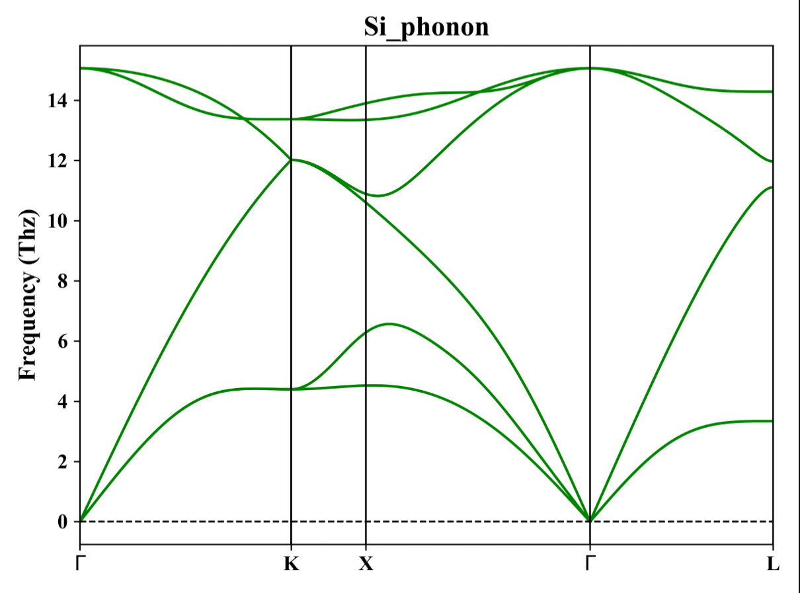
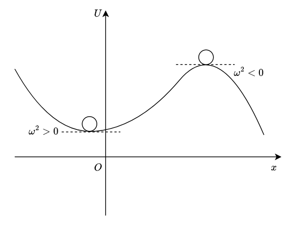

# 计算物理入门

## 物理基础理论

前置课程：

- 高等数学/数学分析
- 线性代数
- 概率论与数理统计
- 高中化学

### DFT理论

密度泛函理论（DFT, Density Functional Theory）是目前较为主流的用于**计算和预测微观物质性质**的理论。

#### 量子力学入门

DFT理论建立在量子力学（Quantumn Mechanics）的框架之上，因此，讨论一些基础的量子力学作为前置知识是必要的。

##### 薛定谔方程

薛定谔方程（Schrodinger equation）用于描述原子或分子的微观状态，**理论上来说**，如果解出了任意一个系统的Schrodinger方程，那么它的微观信息就可以全部计算出来。

最为简单的Schrodinger方程是不含时的、非相对论性的Schrodinger方程，称为*定态非相对论性Schrodinger方程*（Stationary / Time-independent nonrelavistic Schrodinger equation）：

$$\mathcal{H}\varphi = E\varphi$$

其中，$\mathcal{H}$为*哈密顿算符*（Hamiltonian operator），对不同系统形式不同，而$\varphi$为该算符的*本征态*（eigenstate），$E$为该算符的*本征能量*（eigenenergy）。或者用线性代数的语言来说，$\mathcal{H}$数学上表达为一个矩阵，而$\varphi$为一个向量，所以根据本征方程的定义，定态薛定谔方程即为$\mathcal{H}$的本征方程，$\varphi$为本征向量，$E$为本征值。

对于每一个本征值$E_n$，都有不同的本征向量$\varphi_n$与其对应，但一般来说：

- 本征态存在简并性，多个线性无关的本征态可能对应同一个本征能量；
- 存在叠加态，即两个线性无关本征态$\varphi_1$，$\varphi_2$的线性组合
$$\varphi = c_1 \varphi_1 + c_2 \varphi_2$$
但是叠加态一般没有单一的本征值，即**叠加态不属于本征态**；
- 本征态，顾名思义，是能够表征物理唯一性的、最基本的状态，所以不能表达为另外两个本征态的线性组合。

一般来说，我们需要计算的体系包含多个原子核以及比原子核多得多的$N$个电子，则在此情况下，Schrodinger方程可以表达为：
$$\mathcal{H}\varphi = \left[-\frac{\hbar^2}{2m_e}\sum_{i = 1}^{N}\nabla_{i}^2 + \sum_{i = 1}^{N}V(\mathbf{r}_i) + \sum_{i = 1}^{N}\sum_{j<i}U(\mathbf{r}_i, \mathbf{r}_j)\right]\varphi  = E\varphi$$

其中$m_e$为电子质量，括号中的三项求和分别表示每个电子的动能之和、单个电子与所有原子核整体之间的互能之和、每两个原子核之间的互能之和。在此时，$\psi = \varphi$即为电子的波函数。

对于$N$个电子而言，由于每个电子位置都会影响波函数在空间中的分布，所以$\psi$是一个与$N$个三维向量有关的函数，也就是说，$\psi$含有$3N$个独立的变量，这就是精确地解出一个多原子体系的Shrodinger方程十分困难的原因。如果真的将此方程解出，那么得到的本征值$E$即为体系的*基态能量*（ground state energy）

但实际上在实验测量中，我们无法探测粒子在某点的波函数，而只能测量其在该点出现的概率。波函数与概率具有如下关系：
$$P(x,y,z) = \psi^*(x,y,z)\psi(x,y,z) = ||\psi||^2$$

即概率等于波函数的模的平方，其中$\psi^*$为$\psi$的*厄米共轭*（Hermittian conjugation），在这里对复数来说即为复共轭。

另一个相关量即为电子在某处出现的概率密度，或称为电子密度$n(\mathbf{r})$，定义为：
$$n(\mathbf{r}) = 2\sum_{i}\psi_i^*(\mathbf{r})\psi_i(\mathbf{r})$$

式子中的因子2来自于泡利不相容原理（Pauli exclusive principle），是单纯的量子力学效应。由于Pauli原理指出，$\psi$与*自旋*（spin）无关，故两个自旋相反的电子可以具有相同的波函数。

对于$N$电子体系，常用Hartree近似（Hartree approximation）简化计算：
$$\psi \sim \prod_{i = 1}^{N}\psi_i(\mathbf{r})$$

由于电子的费米子（Fermion）特性，实际计算需要用交换关联泛函（Exchange - correlation functional）补足。

##### 密度泛函理论简介

*泛函*（functional）是一类“泛用的函数”，一般来说，（实）函数是一个映射$f:\mathbb{R}\to \mathbb{R}$，即以数值为自变量，输出的因变量也为数值，而泛函是以不同**函数**作为自变量，通过一些算法规则，输出**数值**作为因变量，如以下两个例子：
*Ex. 1*
$$F[f] = \int_{-1}^{1}f(x)\,dx$$
为一个泛函，输入不同函数，输出它在$\left[-1,1\right]$上的积分数值。

*Ex. 2*
在费马原理中，空间中两点之间的每一条路径被一个函数描述，要求光传播的光程最小，所以可以将光程$\mathcal{L}$定义为路径函数的泛函，取变分为0即可得到光路：
$$\delta\mathcal{L}[f] = 0$$

在量子力学体系中，任意一个系统的基态能量$E$均能表达为关于电子密度$n(\mathbf{r})$的泛函$E[n((\mathbf{r}))]$，换言之，由于基态能量由Schrodinger方程解出，每一个$E_n$对应不同的$\psi_n$，所以可以在波函数与电子密度之间建立一个**一一映射**。因此在求解波函数时，可以转而求电子密度。

基态能量和电子密度之间的泛函关系由Hohenberg - Kohn第二定理给出：**该电子密度泛函等价于使总能量取得最小值的电子密度**。

数学上，可以将电子密度泛函以只与单个电子有关的形式表达：

在实际计算中，采用以下方法试探计算电子密度泛函：

#### 凝聚态固体物理入门

首先，介绍固体物理中重要的一些概念。

##### 声子、声子谱及其采样点

- *声子*（phonon）是用于描述晶体的晶格[^1]内原子（谐振子）振动的量子化的*准粒子*（quasi-particle）[^2]，即一个声子所带的能量$\hbar \omega$（$\omega$为该声子对应振动的频率）为该振动模式的能量$E$的最小衡量单位，有：
$$E_n = \left(n+\frac{1}{2}\right)\hbar \omega,\quad \omega = 0,1,2,\dots$$

- *声子谱*（phonon spectrum）是声子所有可能状态的集合，是描述声子能量$\hbar \omega$与动量$\hbar \mathbf{q}$之间对应关系的图像，由于声子能量由振动频率$\omega$唯一确定，动量由声子波矢$\mathbf{q}$唯一确定，所以实际上该图像是$\omega$-$q$图像

一个标准的声子谱如下图所示：

图中横坐标中的$\Gamma$, $K$, $X$, $L$等表示在波矢$q$变化过程中的特殊的高度对称的采样点：
- $\Gamma$点：所有晶格均具有$\Gamma$点，表示晶格的中心点；
- $K$点：六方晶格具有$K$点，表示晶格的角点。

由于晶格的周期性，波矢常常是以周期性变化的，故将一个晶格中波矢不重复的最小区域（以波矢$q$作为自变量衡量[^3]）称为*布里渊区*（Brilliouin zone），画声子谱时一般只画出*第一布里渊区*（The First Brilliouin Zone）的情况。

[^1]: 晶格可以理解为晶体中周期性重复的格点框架
[^2]: 所谓“准粒子”，就是它的行为很像一个标准的实体粒子，但又不是真正可以通过显微镜等观测手段看见的实体
[^3]: 说到区域，一般都是以空间坐标来衡量，这里的布里渊区可以理解为一个“以波矢代替空间坐标的、波矢域上的最小周期”

##### 虚频与结构稳定性

*虚频*（imaginary frequency），顾名思义就是虚数频率，其产生的原因如下，可以使用下图辅助理解：

- 首先，对于一个势能曲线$U(x)$，可以通过Taylor展开至二阶导项证明，在势阱最低点附近系统将表现出简谐运动的行为，且该项写为$\frac{1}{2}\omega^2(x-x_0)^2$的形式后，$\omega$即为系统振动的角频率，在此时$\omega \in \mathbb{R}$，但上述情况为稳态平衡的情况；
- 现在考虑非稳态平衡，即二阶导小于0的情况，此时系统处于势垒处[^4]，同样做Taylor展开至二阶导，此时由于二阶导$U''(x)<0$，我们得到的是一个为负数的$\omega^2$，所以$\omega \in i\mathbb{R}$，成为虚频。我们约定在声子谱的图像中，$i\omega$的虚频表示为$-\omega$，即统一将纯虚数映射为负数频率以可视化；
- 由于此时系统处于非稳态平衡，故结构相应地不稳定，一般不对应最低的能量；
- 需要注意的是，在势能曲线上凸的点做展开均会出现虚频，不一定在势垒最高点。

[^4]: 可以想象，将一个小球放在势能曲线的上方，若小球能保持平衡，但一旦施加一个微扰就破坏了其平衡，就称该点“非稳态平衡”

## 计算机实操技能

### Linux系统实操

#### Linux命令行命令

| 命令 | 选项 | 参数 | 含义 |
| :--- | :--- | :--- | :--- |
| `ls` | [`-a -h -l`] | [Linux路径] | 展示指定路径下的文件及文件夹 |
| `cd` | / | [Linux路径] | 更改工作路径至指定路径 |
| `pwd` | / | / | 打印当前工作路径 |
| `mkdir` |  | [文件路径]/文件夹名 | 在指定路径下创建文件夹 |
| `touch` |  | [文件路径]/文件名 | 在指定路径下创建文件 |
| `find` |  |  | 查找文件位置 |
